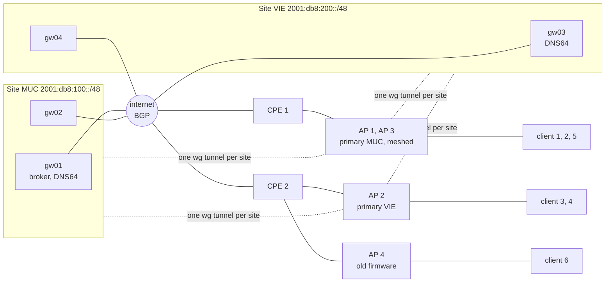

# Multi-PoP lab: active/standby

This branch runs the multi-PoP design with active/standby sites.
The lab name is `ffmuc-mp-as`. The management network is 172.20.40.0/24.
The host bridges start with `as-`. You can run this lab next to the
active/active lab on the same host.

All addresses are documentation addresses. They are not FFMUC prefixes.

## Parts



| Item | MUC | VIE |
|---|---|---|
| Gateways (pgws) | gw01, gw02 | gw03, gw04 |
| Site prefix | 2001:db8:100::/48 | 2001:db8:200::/48 |
| Node /63s (Parker /50) | 2001:db8:100:4000::/50 | 2001:db8:200:4000::/50 |
| DNS64 | 2001:db8:100::53 | 2001:db8:200::53 |
| NAT64 pool4 | 198.51.100.11, .12 | 198.51.100.13, .14 |

- Each site announces only its own prefixes over BGP. There is no routing
  between the sites.
- A node that sends `caps=multiprefix` gets from the broker one /63 from
  each site, a list of all pgws of each site with one preferred pgw, and
  `primary_site`. Home 1 (CPE WAN 203.0.113.1) gets MUC. Home 2
  (203.0.113.5) gets VIE. A node without `caps` gets one site only.
- The broker adds the node peer to all pgws of a site over MQTT. A pgw
  keeps the peer. It installs and announces the node /63 only while the
  handshake is fresh (less than 180 s).

## How the AP works

1. One uradvd sends both client prefixes in each RA. The active prefix has
   preferred lifetime 300 s, valid 600 s. The standby prefix has preferred
   lifetime 0. Clients thus use the active prefix as source. RDNSS has the
   node address of both sites, the active one first. PREF64 is sent while
   a site is up. After a change, the AP sends 3 RAs, 3 s apart.
2. Routing rules: `1000 lookup main suppress_prefixlength 0`, then
   `to <DNS64> iif lo lookup <site>`, then `from <site /64s> lookup <site>`.
   Each site table has `default dev wg_cX`.
3. The IPv4 default route is on the tunnel of the active site. That
   selects the CLAT of that site.
4. Every 10 s the AP sends an ICMPv6 echo to the link-local address of the
   pgw, through wg_cX.
5. When a pgw misses 3 probes, the AP moves the tunnel to the next pgw of
   the same site. The prefix stays preferred. The AP routes through the new
   pgw only after a fresh handshake.
6. When no pgw of a site works, the site is down. Then the AP:
   - makes the other site active and sets the dead prefix to preferred
     lifetime 0;
   - rejects traffic from the dead /63 with ICMPv6 type 1 code 5 (chain
     `parker_src`, from FORWARD and OUTPUT to `wg_c+`). Sources that are not
     node prefixes are also rejected. Outer WireGuard UDP is not affected;
   - moves the IPv4 default route to the other tunnel (IPv4 flows restart);
   - writes the DNS servers of the up sites for dnsmasq;
   - stops sending the dead prefix after 180 s more. The clients remove
     the address when the valid lifetime ends (600 s).
7. A site is up again after 3 probe hits, a fresh handshake and 60 s dwell.
   The AP goes back to the primary site after 120 s more (hold-down).
8. When a site changes state more than 3 times in 10 min, the AP holds it
   down for 600 s (penalty).

## Lab prototypes

The Gluon firmware does not have these functions yet. The lab adds them as
LAB PROTOTYPE files in `gluon/lab-prototype/`. `gluon/launch.py` writes the
files into the AP at the first boot.

- `parker-as.lua`: probe, damping, pgw switch, site state, routing, reject
  rule, RA state, DNS servers, IPv4 default route. It runs every 10 s.
  `/etc/parker-as.tune` (JSON) can change the timers for tests.
- `nodeconfig.sh` hooks: send `caps=multiprefix`, and keep the pgw that
  the AP selected when a new config comes (`parker-as.lua pin`).
- `init.d/gluon-radvd`: one uradvd with `--state-file`. `parker-as.lua`
  writes `/tmp/parker-as/ra-state` and sends SIGHUP. The patch is
  `multipop/patches/uradvd.patch`.
- `init.d/ebpf-clat`: one xlat address per tunnel.
- AP 4 starts with `LAB_FIRMWARE=old`: none of the above.

The broker and worker change is `gateway/packer/multipop/wgkex-multipop.patch`.
The gateway change is `gateway/packer/multipop/overlay.yml`.

Clients: client-1, client-3, client-5 and client-6 use kernel SLAAC.
client-2 and client-4 use dhcpcd for IPv6.

## Known differences from the design

- A site goes down without delay. Dwell, hold-down and penalty delay only
  the way back.
- After a pgw switch, the old pgw can announce the node /63 for up to
  180 s more. In this time, inbound traffic can go to the old pgw.
- The probe is ICMPv6 only. The AP does not use BFD.

## Run it

On an x86-64 Ubuntu 24.04 host with nested KVM, 8 vCPU, 32 GB RAM and
a 64 GB disk:

```sh
mkdir -p artifacts && cp <gluon-ffmuc-...-x86-64.img.gz> artifacts/
./run.sh
```

`run.sh` installs the tools, builds the images, deploys the lab, runs the
tests, collects the logs and destroys the lab. The results go to
`results/summary.json`. The exit code is 0 only when all tests pass.
The tests take about 1.5 h.

To run the tests on a deployed lab:

```sh
tests/multipop_as.py              # all tests
tests/multipop_as.py normal       # one test
```

| Test | Shows |
|---|---|
| ready | All APs are up and on their primary site. |
| normal | IPv6, IPv4 through the CLAT, and DNS64 work. |
| ra-single | One uradvd per AP. Each RA has both prefixes, the standby with preferred lifetime 0. |
| source-prefix | Clients use the primary prefix. The internet sees it. |
| inbound-standby | The internet reaches clients on the standby prefix (ICMP, TCP). |
| pmtu | DF packets through the tunnel of each site get the correct PMTU. |
| old-firmware | AP 4 gets one site. IPv6 and IPv4 work. |
| roam | client-1 moves from AP 1 to AP 3. It gets the AP 3 prefixes. Its old source gets ICMPv6 code 5. |
| pgw-failure | One pgw fails. The AP moves to the other pgw. The prefix stays preferred. IPv6 and IPv4 times are measured. |
| broker-down-pgw | The broker is stopped and a pgw fails. The AP still moves. |
| site-failure-vie | Deprecation, source swap, ICMPv6 code 5, IPv4 failover, prefix removal. |
| recovery-vie | The AP goes back to its primary site after dwell and hold-down. |
| site-failure-long-muc | As above, and the dead address expires on the clients. |
| recovery-long-muc | Recovery after the long outage. |
| flapping | A flapping site is held down (penalty 180 s in the test). |

A failure is made on the internet node: `ip link set gwXX down`.
