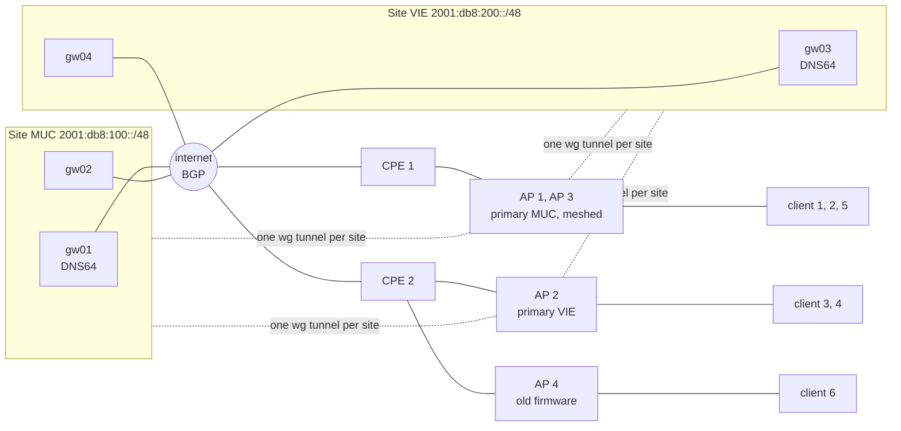
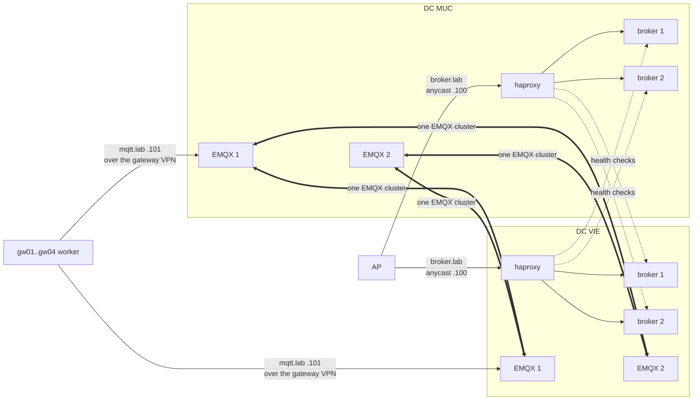

# Multi-PoP lab: active/standby

This branch runs the multi-PoP design with active/standby sites.
The lab name is `ffmuc-mp-as`. The management network is 172.20.40.0/24.
The host bridges start with `as-`. You can run this lab next to the
active/active lab on the same host.

All addresses are documentation addresses. They are not FFMUC prefixes.

## Parts



| Item | MUC | VIE |
|---|---|---|
| Gateways (pgws) | gw01, gw02 | gw03, gw04 |
| Site prefix | 2001:db8:100::/48 | 2001:db8:200::/48 |
| Node /63s (Parker /50) | 2001:db8:100:4000::/50 | 2001:db8:200:4000::/50 |
| DNS64 | 2001:db8:100::53 | 2001:db8:200::53 |
| NAT64 pool4 | 198.51.100.11, .12 | 198.51.100.13, .14 |

- Each site announces only its own prefixes over BGP. There is no routing
  between the sites.
- A node that sends `caps=multiprefix` gets from the broker one /63 from
  each site, a list of all pgws of each site with one preferred pgw, and
  `primary_site`. Home 1 (CPE WAN 203.0.113.1) gets MUC. Home 2
  (203.0.113.5) gets VIE. A node without `caps` gets one site only.
- The broker adds the node peer to all pgws of a site over MQTT. A pgw
  keeps the peer. It installs and announces the node /63 only while the
  handshake is fresh (less than 180 s). The worker checks this every 1 s.
- After a pgw switch, the AP reports the new pgw to the broker
  (`GET /api/v3/lab/switch`). The broker tells the other pgws of that site
  over MQTT (`LabUnroute`) to remove the node /63 at once. They keep the
  peer. The route comes back only after a new handshake. The 180 s limit
  is only a safety net, for example when no broker answers.

## Broker plane

The broker plane has the same layout as wgkex in production
(ffmuc-salt-public `wgkex/`). It is in `multipop/brokers/`.



- Each site has 2 brokers, 2 EMQX 5.8 nodes, 1 haproxy and 1 DC router.
  No part is behind a pgw.
- The 4 EMQX nodes are one cluster (static seeds). Each broker uses the
  EMQX node next to it.
- The brokers keep no state of their own. The /63 of a node comes from a
  hash of its public key. The pgw lists and `primary_site` come from the
  config file. Worker state comes from MQTT. Thus all brokers give the
  same answer.
- `broker.lab` (198.51.100.100) is an anycast address. Each DC router
  announces it over BGP while its haproxy is healthy (checked every 1 s).
  The haproxy backend is all 4 brokers, with health checks. haproxy sets
  `X-Forwarded-For`. The brokers trust it only from the haproxy addresses.
- `mqtt.lab` (198.51.100.101) is an ECMP route on each DC router to the
  healthy local EMQX nodes. The DC routers announce it to the gateways
  over the gateway VPN, like `ov.ffmuc.net` in production. Thus the
  workers reach MQTT also when a test cuts a gateway uplink.
- The AP knows only the name `broker.lab`.

Findings for production:

- EMQX `dist_net_ticktime` is 2 min by default. In this time a dead EMQX
  node stays in the cluster. A worker with a fixed client ID cannot
  connect to another node ("failed_to_kick_session_on_remote_node").
  The lab sets 10 s.
- waitress 2.x removes `X-Forwarded-For` unless the peer is a trusted
  proxy, and it trusts only one proxy address. The broker patch turns
  this off when `trusted_proxies` is set and checks the proxy address
  itself.

## How the AP works

1. One uradvd sends both client prefixes in each RA. The active prefix has
   preferred lifetime 300 s, valid 600 s. The standby prefix has preferred
   lifetime 0. Clients thus use the active prefix as source. RDNSS has the
   node address of both sites, the active one first. PREF64 is sent while
   a site is up. After a change, the AP sends 3 RAs, 3 s apart.
2. Routing rules: `1000 lookup main suppress_prefixlength 0`, then
   `to <DNS64> iif lo lookup <site>`, then `from <site /64s> lookup <site>`.
   Each site table has `default dev wg_cX`.
3. The IPv4 default route is on the tunnel of the active site. That
   selects the CLAT of that site.
4. Every 1 s the AP sends an ICMPv6 echo to the address of the current
   pgw, through wg_cX. The reject rule lets this probe pass, also while
   the site is down.
5. When a pgw misses 3 probes (about 3 s), the AP moves the tunnel to the
   next pgw of the same site. The prefix stays preferred. The AP routes
   through the new pgw only after a fresh handshake. Then it reports the
   switch to the broker (again every 3 s until the broker answers).
6. When no pgw of a site works, the site is down. This takes about 3 s for
   each pgw of the site (about 6 s for 2 pgws). Then the AP at once:
   - makes the other site active and sets the dead prefix to preferred
     lifetime 0;
   - rejects traffic from the dead /63 with ICMPv6 type 1 code 5 (chain
     `parker_src`, from FORWARD and OUTPUT to `wg_c+`). Sources that are not
     node prefixes are also rejected. Outer WireGuard UDP is not affected;
   - moves the IPv4 default route to the other tunnel (IPv4 flows restart);
   - writes the DNS servers of the up sites for dnsmasq;
   - sends 3 RAs with the new lifetimes.

   180 s later, the AP stops sending the dead prefix. The clients remove
   the address when the valid lifetime ends (600 s).
7. A site is up again after 3 probe hits, a fresh handshake and 10 s dwell.
   The AP then goes back to the primary site at once (no hold-down).
   Existing client flows on the other prefix continue. New flows use the
   primary prefix.
8. When a site changes state more than 3 times in 10 min, the AP holds it
   down for a penalty. The penalty is 60 s and doubles for each new
   penalty, up to 600 s. 10 min without changes resets it.

## Lab prototypes

The Gluon firmware does not have these functions yet. The lab adds them as
LAB PROTOTYPE files in `gluon/lab-prototype/`. `gluon/launch.py` writes the
files into the AP at the first boot.

- `parker-as.lua`: probe, damping, pgw switch, site state, routing, reject
  rule, RA state, DNS servers, IPv4 default route. It runs as a loop with
  a 1 s tick. It applies the full state after a change and every 10 s.
  `/etc/parker-as.tune` (JSON) can change the timers for tests.
- `nodeconfig.sh` hooks: send `caps=multiprefix`, and keep the pgw that
  the AP selected when a new config comes (`parker-as.lua pin`).
- `init.d/gluon-radvd`: one uradvd with `--state-file`. `parker-as.lua`
  writes `/tmp/parker-as/ra-state` and sends SIGHUP. The patch is
  `multipop/patches/uradvd.patch`.
- `init.d/ebpf-clat`: one xlat address per tunnel.
- AP 4 starts with `LAB_FIRMWARE=old`: none of the above.

The broker and worker change is `gateway/packer/multipop/wgkex-multipop.patch`.
The gateway change is `gateway/packer/multipop/overlay.yml`.

Clients: client-1, client-3, client-5 and client-6 use kernel SLAAC.
client-2 and client-4 use dhcpcd for IPv6.

## Known differences from the design

- A site goes down without delay. Dwell and penalty delay only the way
  back.
- When no broker answers, the report cannot go out. The old pgw then
  removes the /63 after the 180 s safety net. In this time, inbound
  traffic can go to the old pgw.
- `/api/v3/lab/switch` has no authentication (lab prototype). A false call
  removes the route of a node only until its next handshake.
- The probe is ICMPv6 only. The AP does not use BFD.

## Run it

On an x86-64 Ubuntu 24.04 host with nested KVM, 8 vCPU, 16 GB RAM and a
128 GB disk (for example Azure Standard_F8s_v2):

```sh
mkdir -p artifacts && cp <gluon-ffmuc-...-x86-64.img.gz> artifacts/
./run.sh
```

`run.sh` installs the tools, builds the images, deploys the lab, runs the
tests, collects the logs and destroys the lab. The results go to
`results/summary.json`. The exit code is 0 only when all tests pass.
The tests take about 1.5 h.

The four gateway disks (`gateway/parker-gw0X.qcow2`) are not in a Docker
image. containerlab binds each disk read-only into its gateway container.
Do not delete them while the lab runs.

`summary.json` has the measured downtimes in `downtime`:

- `ap`: seconds until the AP status shows the change: `intra_site_switch_s`,
  `old_pgw_unroute_s` (after the switch), `site_down_s`, `clients_swapped_s`,
  `site_up_s`, `switch_back_s`, `inbound_after_switch_s`, `penalty_hold_s`.
- `clients`: the outage as each client sees it, for each case (pgw switch,
  site failover, switch-back, broker down, flapping). During the case each
  client sends ping6 and ping4 every 100 ms, keeps one TCP stream open for
  IPv6 and IPv4, and opens a new HTTP connection every 1 s for IPv6 and
  IPv4 (`tests/clientmon.sh`, server `tests/monsrv.py` on the internet
  node). Values: the longest gap with no ping reply (`ping6_max_gap_ms`,
  `ping4_max_gap_ms`), lost pings, if the TCP stream survived
  (`tcp6_survived`, `tcp4_survived`), and the time from the failure until a
  new connection works (`new_conn6_s`, `new_conn4_s`, 0 when no connection
  failed). The raw logs are in `results/mon-*.log`.

Each ping runs for 1 s and then starts again, so a new ping selects the
source address again, like a new application. After a site failover, an
old TCP stream on the dead prefix stops (ICMPv6 code 5). The IPv4 TCP
stream stops after each pgw change, because the NAT64 address changes.

To run the tests on a deployed lab:

```sh
tests/multipop_as.py              # all tests
tests/multipop_as.py normal       # one test
```

| Test | Shows |
|---|---|
| ready | All APs are up and on their primary site. |
| normal | IPv6, IPv4 through the CLAT, and DNS64 work. |
| ra-single | One uradvd per AP. Each RA has both prefixes, the standby with preferred lifetime 0. |
| source-prefix | Clients use the primary prefix. The internet sees it. |
| inbound-standby | The internet reaches clients on the standby prefix (ICMP, TCP). |
| pmtu | DF packets through the tunnel of each site get the correct PMTU. |
| old-firmware | AP 4 gets one site. IPv6 and IPv4 work. |
| roam | client-1 moves from AP 1 to AP 3. It gets the AP 3 prefixes. Its old source gets ICMPv6 code 5. |
| plane | The EMQX cluster has 4 nodes. All brokers and `broker.lab` are healthy. The gateways reach `mqtt.lab` over the VPN. |
| pgw-failure | One VIE pgw fails (home 2). The AP moves to the other pgw. The prefix stays preferred. The old pgw removes the /63 in less than 15 s. Client outage is measured. |
| pgw-failure-home1 | As above, for gw01 (home 1, MUC). |
| plane-broker-down | broker-muc-1 is cut off. Then a pgw fails. The report goes through another broker. The old pgw removes the /63 in the normal limit. |
| plane-emqx-down | As above, with emqx-muc-1 cut off. |
| plane-haproxy-down | As above, with the MUC haproxy cut off. `broker.lab` moves to VIE. |
| broker-down-pgw | All brokers are cut off and a pgw fails. The AP still moves. The report waits for a broker. |
| site-failure-vie | Deprecation, source swap, ICMPv6 code 5, IPv4 failover, prefix removal. Client outage is measured. |
| recovery-vie | The AP goes back to its primary site after dwell, with no hold-down. Client traffic does not stop. |
| site-failure-long-muc | As above, and the dead address expires on the clients. |
| recovery-long-muc | Recovery after the long outage. |
| flapping | A flapping site is held down for the penalty (60 s). |

A failure is made on the internet node: `ip link set gwXX down`.
