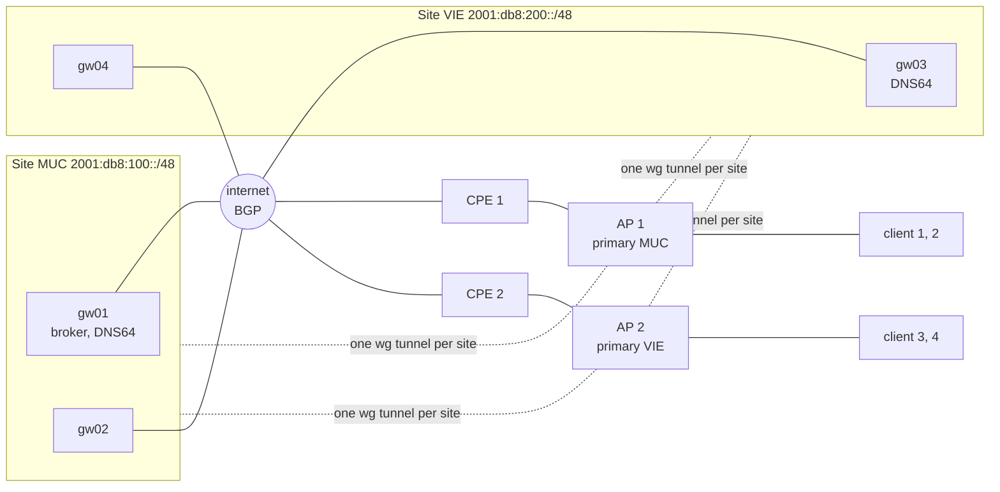

# Multi-PoP lab: active/standby

This branch runs the multi-PoP design with active/standby sites.
The lab name is `ffmuc-mp-as`. The management network is 172.20.40.0/24.
The host bridges start with `as-`. You can run this lab next to the
active/active lab on the same host.

All addresses are documentation addresses. They are not FFMUC prefixes.

## Parts



| Item | MUC | VIE |
|---|---|---|
| Gateways | gw01, gw02 | gw03, gw04 |
| Site prefix | 2001:db8:100::/48 | 2001:db8:200::/48 |
| Node /63s (Parker /50) | 2001:db8:100:4000::/50 | 2001:db8:200:4000::/50 |
| DNS64 | 2001:db8:100::53 | 2001:db8:200::53 |
| NAT64 pool4 | 198.51.100.11, .12 | 198.51.100.13, .14 |

- Each site announces only its own prefixes over BGP. There is no routing
  between the sites.
- The broker gives each node one /63 from each site, and `primary_site`.
  Home 1 (CPE WAN 203.0.113.1) gets MUC. Home 2 (203.0.113.5) gets VIE.
- Each AP has one WireGuard tunnel to each site.

## How the AP works

1. The AP sends both /64 client prefixes in its RA. The primary prefix has
   preferred lifetime 120 s. The standby prefix has preferred lifetime 0.
   Clients thus use the primary prefix as source.
2. Source routing sends each prefix into the tunnel of its site. Inbound
   traffic to the standby prefix also works.
3. The CLAT on each tunnel uses the xlat /64 of that site. The IPv4 default
   route goes to the primary tunnel.
4. A site is dead when its tunnel has no handshake for 180 s. Then the AP:
   - makes the other site preferred and sets the dead prefix to preferred
     lifetime 0;
   - rejects traffic from the dead prefix with ICMPv6 type 1 code 5;
   - moves the IPv4 default route to the live tunnel (IPv4 flows restart);
   - stops sending the dead prefix after 180 s more.
5. When the primary site is live again, the AP goes back to it.

## Lab prototypes

The Gluon firmware does not have these functions yet. The lab adds them as
LAB PROTOTYPE files in `gluon/lab-prototype/`. `gluon/launch.py` writes the
files into the AP at the first boot.

- `parker-as.lua`: site state, source routing, reject rule, RA and CLAT
  settings, IPv4 default route. It runs every 5 s.
- `init.d/gluon-radvd`: one uradvd that sends both prefixes in one RA,
  each with its own lifetimes. `parker-as.lua` writes the prefixes to
  `/tmp/parker-as/ra-state` and sends SIGHUP. uradvd reads the file again.
  The patch is `multipop/patches/uradvd.patch`. The gluon image builds it,
  and `launch.py` copies it into the AP.
- `init.d/ebpf-clat`: one xlat address per tunnel.

The broker change is `gateway/packer/multipop/wgkex-multipop.patch`. The
gateway change is `gateway/packer/multipop/overlay.yml`.

Clients: client-1 and client-3 use kernel SLAAC. client-2 and client-4
use dhcpcd for IPv6. The tests run on both client types.

## Run it

On an x86-64 Ubuntu 24.04 host with nested KVM, 8 vCPU, 32 GB RAM and
40 GB free disk:

```sh
mkdir -p artifacts && cp <gluon-ffmuc-...-x86-64.img.gz> artifacts/
./run.sh
```

`run.sh` installs the tools, builds the images, deploys the lab, runs the
tests, collects the logs and destroys the lab. The results go to
`results/summary.json`. The exit code is 0 only when all tests pass.

To run the tests on a deployed lab:

```sh
tests/multipop_as.py              # all tests
tests/multipop_as.py normal       # one test
```

| Test | Shows |
|---|---|
| ready | Each AP has two live sites and the correct primary. |
| normal | IPv6, IPv4 through the CLAT, and DNS64 work. |
| ra-single | One uradvd per AP. Each RA has both prefixes, the standby with preferred lifetime 0. |
| source-prefix | Clients use the primary prefix. The internet sees it. |
| inbound-standby | The internet reaches clients on the standby prefix (ICMP, TCP). |
| failover-vie, failover-muc | Deprecation, source swap, ICMPv6 code 5, IPv4 failover, prefix removal. |
| recovery-vie, recovery-muc | The AP goes back to its primary site. |

A failure is made on the internet node: `ip link set gwXX down` for the
two gateways of a site.
