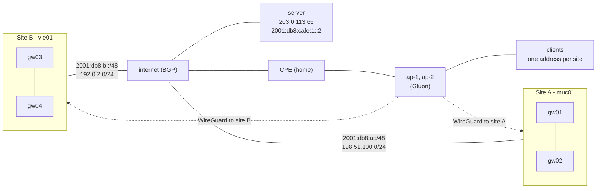

# Multi-PoP lab (active/active)

This branch runs the Parker multi-PoP design with two sites. Both sites are
active at the same time. Each client gets one address from each site and
selects the source address itself.

## Parts



| Part | Site A (muc01) | Site B (vie01) |
|---|---|---|
| Gateways | gw01, gw02 | gw03, gw04 |
| BGP announcement | 2001:db8:a::/48, 198.51.100.0/24 | 2001:db8:b::/48, 192.0.2.0/24 |
| Node pool (Parker) | 2001:db8:a::/50 | 2001:db8:b::/50 |
| NAT64 pool4 | 198.51.100.11, .12 | 192.0.2.13, .14 |
| DNS64 (anycast in the site) | 2001:db8:a::53 | 2001:db8:b::53 |

- There is no routing between the sites. iBGP runs only inside a site.
- PREF64 is 64:ff9b::/96 at both sites.
- The broker (on gw01) gives each node one /63 from each site. The first /64
  is the client LAN. The second /64 is the CLAT xlat range.
- The test server echoes the source address of each request on TCP port 8080.

## How the node works

The firmware does not have the multi-PoP functions yet. The lab adds them as
**lab prototypes** in `gluon/multipop/`. `gluon/launch.py` installs them over
the serial console. They are not production code.

1. The broker sends, for each site, a list of all its gateways (endpoint,
   key, tunnel address) with one gateway marked as preferred, and
   `primary_site`. It adds the node key to all gateways of the site. A
   gateway installs the route to the node /63 only after a handshake that is
   less than 180 s old. A node without `caps=multiprefix` (old firmware)
   gets one site only.
2. One WireGuard tunnel goes to each site (`wg_c1` site A, `wg_c2` site B).
3. Routing: rule 1000 `lookup main suppress_prefixlength 0` comes first.
   Then each site has a table with `default dev wg_cX`, a rule for its
   prefix, and a rule `to <DNS64> iif lo` for the node itself.
4. Every 10 s the node pings its gateway through each tunnel. A site goes
   down after 3 misses. It comes up after 3 hits and a handshake that is
   less than 180 s old. Damping: a site stays at least 60 s in one state.
   More than 3 changes in 10 minutes give a penalty of 600 s.
5. After 3 misses, the node also changes to the next gateway of the site.
6. When a site is down:
   - the node sends that prefix with preferred lifetime 0,
   - the `parker_src` ip6tables chain rejects packets from that prefix with
     ICMPv6 type 1 code 5 (`icmp6-policy-fail`). The chain also rejects
     sources that are not the node prefixes. It does not touch the outer
     WireGuard UDP packets. FORWARD and OUTPUT jump to the chain for
     `-o wg_c+`. A fw3 include adds the jumps again after a reload,
   - after `MP_WITHDRAW_AFTER` seconds (lab: 120 s), the node stops sending
     that prefix.
7. The active tunnel is the primary site while it is up. The IPv4 default
   route (with it the CLAT) and the main IPv6 default use the active tunnel.
   After a failover, the node goes back to the primary site only after it
   was up for 120 s.
8. One uradvd sends one RA with the prefixes of both sites (preferred 300 s,
   valid 600 s), RDNSS with the node address of each site, and PREF64 while
   a tunnel is up. On a change, the node sends SIGHUP 3 times, 3 s apart.
   The patch is `multipop/patches/uradvd.patch`.
9. dnsmasq gets the DNS64 server of the live sites, the active site first,
   on each change.

Set other times in `/etc/multipop.conf` on the node (see `mp-node.sh`).

**Lab deviation:** the lab gateways have no link-local address on the
tunnel, and they accept only the node /63 as source. The probe goes from
the node site address to the gateway tunnel address. The chain lets this
probe pass also when the site is down.

IPv4 flows restart after a failover, because the NAT64 pool changes.

## Run

On a Linux host with nested KVM and sudo:

```sh
./run.sh
```

`run.sh` installs the tools, builds the images, deploys the lab
(`ffmuc-mp-aa`, management network 172.31.20.0/24), runs all tests, collects
logs and destroys the lab. The results are in `results/summary.json`.
`run.sh` exits with 0 only if all tests pass.

Put a prebuilt Parker x86-64 image (`*.img.gz`) in `multipop/firmware/`, or
set `FIRMWARE=<path>`.

## Tests

| Test | What it shows |
|---|---|
| `normal.sh` | Each site announces only its prefixes. Each client has an address from each site. IPv6, DNS64 and NAT64 work through each site. IPv4 works through the CLAT. |
| `ra-single.sh` | The node sends one RA with both prefixes. No client address becomes deprecated. client-2 and client-4 use dhcpcd for IPv6, the other clients use the kernel. |
| `source-prefix.sh` | The source prefix that each client uses by default. |
| `rule8-tie.sh` | To the DNS64 of a site, the client uses the address of that site. To other destinations (a tie in RFC 6724 rule 8), the source is in one site, stays the same, and works. |
| `pmtu.sh` | Per site: a packet of the tunnel MTU arrives, 1 byte more gives "packet too big". The same for IPv4 through the CLAT. |
| `roam.sh` | client-1 moves from ap-1 to ap-2. It gets the ap-2 prefixes and uses them. An old ap-1 source works or fails fast. |
| `pgw-failure.sh` | One site B gateway fails. The node changes to the other gateway of site B. IPv6 (same address) and IPv4 are checked separately. |
| `broker-down.sh` | The same, with the broker stopped. |
| `site-failure.sh` | Site B fails. The site B address becomes deprecated. Traffic from it is rejected. IPv4 moves to site A. The prefix is withdrawn and expires. |
| `recovery.sh` | Site B comes back. The prefix is preferred again. IPv6, NAT64 and IPv4 work through site B. |
| `flapping.sh` | Site B goes down and up many times. The node sets the penalty and keeps site B down. After the penalty, site B comes up. |
| `long-outage.sh` | Site B is down for longer than 180 s. The reject rule is active. After the return, the handshake renews, the gateway has the route again, and traffic works. |
| `old-firmware.sh` | A node without `caps=multiprefix` gets one site, without the multi-site fields. |

`multipop/tests/uradvd-smoke.sh` tests the uradvd patch alone in a Docker
container, without the lab.
