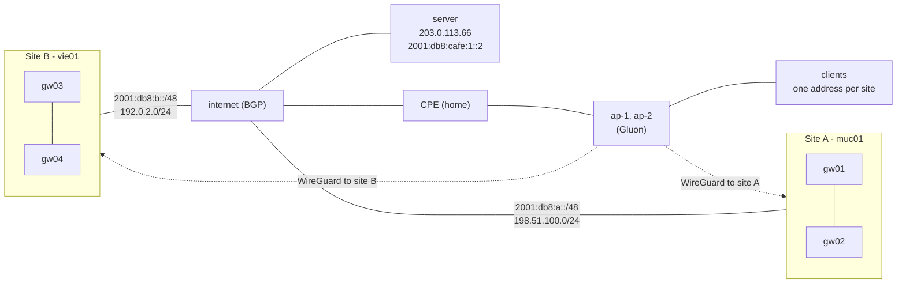
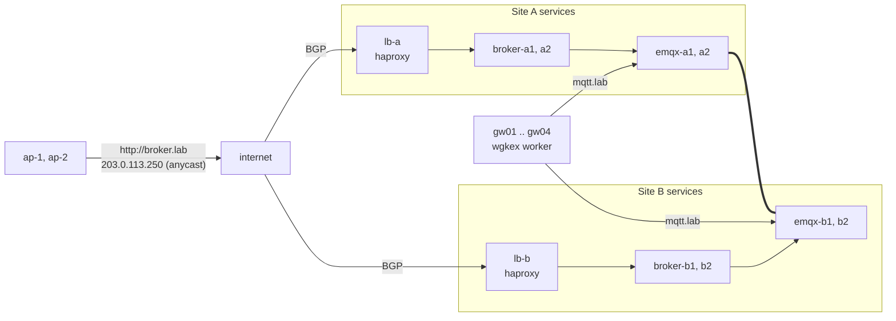

# Multi-PoP lab (active/active)

This branch runs the Parker multi-PoP design with two sites. Both sites are
active at the same time. Each client gets one address from each site and
selects the source address itself.

## Parts



| Part | Site A (muc01) | Site B (vie01) |
|---|---|---|
| Gateways | gw01, gw02 | gw03, gw04 |
| BGP announcement | 2001:db8:a::/48, 198.51.100.0/24 | 2001:db8:b::/48, 192.0.2.0/24 |
| Node pool (Parker) | 2001:db8:a::/50 | 2001:db8:b::/50 |
| NAT64 pool4 | 198.51.100.11, .12 | 192.0.2.13, .14 |
| DNS64 (anycast in the site) | 2001:db8:a::53 | 2001:db8:b::53 |

- There is no routing between the sites. iBGP runs only inside a site.
- PREF64 is 64:ff9b::/96 at both sites.
- The broker gives each node one /63 from each site. The first /64 is the
  client LAN. The second /64 is the CLAT xlat range.
- The test server echoes the source address of each request on TCP port 8080.

## Control plane

The control plane has the same layout as the FFMUC wgkex setup in
production. No part of it is behind a gateway, and no single part is
necessary.



| Part | Site A | Site B | Function |
|---|---|---|---|
| haproxy (`lb-a`, `lb-b`) | 203.0.113.130 | 203.0.113.146 | Announces `broker.lab` (203.0.113.250) with BGP while haproxy runs. Sends requests to a healthy broker, own site first. Sets `X-Forwarded-For`. |
| broker | .131, .132 | .147, .148 | Stateless wgkex broker. Each uses the EMQX node next to it. `/api/health` is 200 only while MQTT is connected. |
| EMQX 5.8 | .133, .134 | .149, .150 | One cluster of 4 nodes (static seeds). |

- The brokers keep no state. The /63 allocations are retained MQTT
  messages (`parker/ipam/<site>/<key>`). The allocation is deterministic
  (hash of the key), so two brokers give the same /63.
- The gateways use the name `mqtt.lab`. It has the addresses of all EMQX
  nodes, the own site first. When a node fails, the worker connects to the
  next one.
- The switch report goes to any broker. The broker sends the drop-route
  message retained, so a worker that reconnects still gets it.
- **Lab limit:** the CPE resolves `broker.lab`. The production name is
  served by DNS.

## How the node works

The firmware does not have the multi-PoP functions yet. The lab adds them as
**lab prototypes** in `gluon/multipop/`. `gluon/launch.py` installs them over
the serial console. They are not production code.

1. The broker sends, for each site, a list of all its gateways (endpoint,
   key, tunnel address) with one gateway marked as preferred, and
   `primary_site`. It adds the node key to all gateways of the site. A
   gateway installs the route to the node /63 only after a handshake that is
   less than 180 s old. A node without `caps=multiprefix` (old firmware)
   gets one site only.
2. One WireGuard tunnel goes to each site (`wg_c1` site A, `wg_c2` site B).
3. Routing: rule 1000 `lookup main suppress_prefixlength 0` comes first.
   Then each site has a table with `default dev wg_cX`, a rule for its
   prefix, and a rule `to <DNS64> iif lo` for the node itself.
4. Every 1 s the node pings its gateway through each tunnel. After 3
   misses (about 3 s), the node changes to the next gateway of the same
   site. This does not change the site state: the prefix stays preferred.
   The new gateway routes the node /63 only after a fresh handshake.
5. After the fresh handshake with the new gateway, the node reports the
   change to the broker (`POST /api/v3/switch`: key, old and new gateway).
   The broker tells the old gateway over MQTT (`parker/drop-route/<gw>`) to
   remove the route to the node /63 at once. The old gateway keeps the peer.
   It installs the route again only after a newer handshake. The 180 s
   handshake timeout stays as a safety net (for example when the broker is
   down). **Lab limit:** the report is not authenticated.
6. A site goes down at once when all its gateways failed (3 misses each).
   It comes up after 3 hits, a handshake that is newer than the failure,
   and a dwell of 10 s. More than 3 changes in 10 minutes give a penalty of
   30 s. Each further penalty doubles, up to 600 s. A quiet window resets
   it.
7. When a site is down:
   - the node sends that prefix with preferred lifetime 0,
   - the `parker_src` ip6tables chain rejects packets from that prefix with
     ICMPv6 type 1 code 5 (`icmp6-policy-fail`). The chain also rejects
     sources that are not the node prefixes. It does not touch the outer
     WireGuard UDP packets. FORWARD and OUTPUT jump to the chain for
     `-o wg_c+`. A fw3 include adds the jumps again after a reload. The
     node removes type 1 from `net.ipv6.icmp.ratemask`, so the per-client
     ICMPv6 rate limit does not drop the reject of a new connection,
   - the node sends the RA burst at once,
   - after `MP_WITHDRAW_AFTER` seconds (lab: 120 s), the node stops sending
     that prefix. The broker keeps a site with no online pgw in its answer,
     so a config fetch during the outage does not remove the tunnel.
8. The active tunnel is the primary site while it is up. The IPv4 default
   route (with it the CLAT) and the main IPv6 default use the active tunnel.
   The node goes back to the primary site as soon as the site is up again
   (item 6). There is no other hold-down.
9. One uradvd sends one RA with the prefixes of both sites (preferred 300 s,
   valid 600 s), RDNSS with the node address of each site, and PREF64 while
   a tunnel is up. On a change, the node sends SIGHUP 3 times, 3 s apart.
   The patch is `multipop/patches/uradvd.patch`.
10. dnsmasq gets the DNS64 server of the live sites, the active site first,
   on each change. The node resolves the `.lab` names (gateways and broker)
   through the WAN resolver (`gluon-wan-dnsmasq`, port 54), because the DNS64
   does not know them. Before a gateway change, the node resolves the name to
   an address and gives the address to `wg`. If no answer comes, the node
   uses the last good address.

Set other times in `/etc/multipop.conf` on the node (see `mp-node.sh`).
The node writes its events (site up or down, gateway change, report,
active tunnel, penalty) to `/tmp/multipop/events`.

**Lab deviation:** the lab gateways have no link-local address on the
tunnel, and they accept only the node /63 as source. The probe goes from
the node site address to the gateway tunnel address. The chain lets this
probe pass also when the site is down.

IPv4 flows restart after a failover, because the NAT64 pool changes.

## Run

On a Linux host with nested KVM and sudo:

```sh
./run.sh
```

`run.sh` installs the tools, builds the images, deploys the lab
(`ffmuc-mp-aa`, management network 172.31.20.0/24), runs all tests, collects
logs and destroys the lab. The results are in `results/summary.json`.
`run.sh` exits with 0 only if all tests pass.

Put a prebuilt Parker x86-64 image (`*.img.gz`) in `multipop/firmware/`, or
set `FIRMWARE=<path>`.

## Tests

| Test | What it shows |
|---|---|
| `normal.sh` | Each site announces only its prefixes. Each client has an address from each site. IPv6, DNS64 and NAT64 work through each site. IPv4 works through the CLAT. |
| `ra-single.sh` | The node sends one RA with both prefixes. No client address becomes deprecated. client-2 and client-4 use dhcpcd for IPv6, the other clients use the kernel. |
| `source-prefix.sh` | The source prefix that each client uses by default. |
| `rule8-tie.sh` | To the DNS64 of a site, the client uses the address of that site. To other destinations (a tie in RFC 6724 rule 8), the source is in one site, stays the same, and works. |
| `pmtu.sh` | Per site: a packet of the tunnel MTU arrives, 1 byte more gives "packet too big". The same for IPv4 through the CLAT. |
| `roam.sh` | client-1 moves from ap-1 to ap-2. It gets the ap-2 prefixes and uses them. An old ap-1 source works or fails fast. |
| `pgw-failure.sh` | One site B gateway fails (the internet drops its WireGuard packets; BGP and MQTT stay up). The node changes to the other gateway of site B. Site B stays up and preferred: no client address becomes deprecated. IPv6 (same address) and IPv4 are checked separately. The old gateway removes the node /63 a few seconds after the report. |
| `broker-kill.sh` | One broker fails, then a gateway fails. The report goes through another broker. The old gateway removes the route within 10 s after the report. |
| `emqx-kill.sh` | The EMQX node of the old gateway's worker fails. The worker connects to another node. Then the same as `broker-kill.sh`. |
| `haproxy-kill.sh` | The haproxy that the home uses fails. BGP moves `broker.lab` to the other haproxy. Then the same as `broker-kill.sh`. |
| `broker-down.sh` | The same, with all brokers stopped. The old gateway removes the route after the 180 s timeout. |
| `site-failure.sh` | Site B fails. The site B address becomes deprecated. Traffic from it is rejected. IPv4 moves to site A. The prefix is withdrawn and expires. |
| `recovery.sh` | Site B comes back. The prefix is preferred again. IPv6, NAT64 and IPv4 work through site B. |
| `site-a-failover.sh` | Site A (primary, with IPv4) fails: IPv4 and new IPv6 connections move to site B. Site A comes back: IPv4 moves back. |
| `flapping.sh` | Site B goes down and up many times. The node sets the penalty and keeps site B down. After the penalty, site B comes up. |
| `long-outage.sh` | Site B is down for longer than 180 s. The reject rule is active. After the return, the handshake renews, the gateway has the route again, and traffic works. |
| `old-firmware.sh` | A node without `caps=multiprefix` gets one site, without the multi-site fields. |

### Outage that the clients see

During each failover case (`pgw_switch`, `broker_down`, `site_failover_b`,
`site_failover_a`, `switch_back`, `flapping`), each client sends to the test
server (`outage-client.sh`):

- ping6 from its site A address, ping6 from its site B address, and ping4,
  every 100 ms,
- one long TCP stream over IPv6 and one over IPv4,
- one new HTTP connection every 1 s over IPv6 and over IPv4.

In `pgw_switch` and `broker_down`, the server also pings the site B address
of client-1 (inbound). `outage.py` reads the results. Each test JSON has
`metrics.<case>`:

| Field | Meaning |
|---|---|
| `clients.<client>.ping6a/ping6b/ping4` | `max_gap_ms` (the longest time with no reply), `lost`, `sent` |
| `clients.<client>.tcp6/tcp4` | `source`, `survived` (the stream was still open at the end), `max_gap_ms` |
| `clients.<client>.curl6/curl4` | `new_conn_ms` (from the cut until a new connection works), `failed`, `slowest_ms` |
| `inbound` | the server ping to the client: `max_gap_ms`, `lost` |
| `downtime_s` | the worst client, in seconds: `ipv6_a`, `ipv6_b`, `ipv4`, `new_conn_ipv6`, `new_conn_ipv4`, `inbound`. In a site failover, the ping of the failed site is `"site down"` |
| `node` | node times after the cut, in seconds: `detection_s`, `switch_reported_s`, `old_route_gone_s`, `active_change_s`, `penalty_s` |

`summary.json` has `downtime`: `downtime_s` and `node` for each case. The
node clock has 1 s steps, and the serial console adds about 1 s of error to
the node times. A dead source (for example the site B address after a site
B failure) has no reply until the end. For it, `new_conn_ms` is the
important number.

`multipop/tests/uradvd-smoke.sh` tests the uradvd patch alone in a Docker
container, without the lab.
