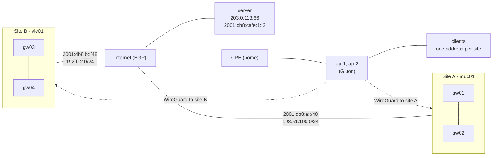

# Multi-PoP lab (active/active)

This branch runs the Parker multi-PoP design with two sites. Both sites are
active at the same time. Each client gets one address from each site and
selects the source address itself.

## Parts



| Part | Site A (muc01) | Site B (vie01) |
|---|---|---|
| Gateways | gw01, gw02 | gw03, gw04 |
| BGP announcement | 2001:db8:a::/48, 198.51.100.0/24 | 2001:db8:b::/48, 192.0.2.0/24 |
| Node pool (Parker) | 2001:db8:a::/50 | 2001:db8:b::/50 |
| NAT64 pool4 | 198.51.100.11, .12 | 192.0.2.13, .14 |
| DNS64 (anycast in the site) | 2001:db8:a::53 | 2001:db8:b::53 |

- There is no routing between the sites. iBGP runs only inside a site.
- PREF64 is 64:ff9b::/96 at both sites.
- The broker (on gw01) gives each node one /63 from each site. The first /64
  is the client LAN. The second /64 is the CLAT xlat range.
- The test server echoes the source address of each request on TCP port 8080.

## How the node works

The firmware does not have the multi-PoP functions yet. The lab adds them as
**lab prototypes** in `gluon/multipop/`. `gluon/launch.py` installs them over
the serial console. They are not production code.

1. One WireGuard tunnel goes to each site.
2. Both client prefixes go into the router advertisement (one uradvd instance
   for each site).
3. Source routing sends each prefix only into the tunnel of its site.
4. The node pings the gateway through each tunnel. When a tunnel fails:
   - the node sends that prefix with preferred lifetime 0,
   - the node rejects packets from that prefix with ICMPv6 type 1 code 5,
   - the node moves the IPv4 default route (the CLAT) to a live tunnel,
   - after `MP_WITHDRAW_AFTER` seconds (default 120 s), the node stops
     sending that prefix.
5. When the tunnel is up again, the node sends the prefix as preferred again.

IPv4 flows restart after a failover, because the NAT64 pool changes.

## Run

On a Linux host with nested KVM and sudo:

```sh
./run.sh
```

`run.sh` installs the tools, builds the images, deploys the lab
(`ffmuc-mp-aa`, management network 172.31.20.0/24), runs all tests, collects
logs and destroys the lab. The results are in `results/summary.json`.
`run.sh` exits with 0 only if all tests pass.

Put a prebuilt Parker x86-64 image (`*.img.gz`) in `multipop/firmware/`, or
set `FIRMWARE=<path>`.

## Tests

| Test | What it shows |
|---|---|
| `normal.sh` | Each site announces only its prefixes. Each client has an address from each site. IPv6, DNS64 and NAT64 work through each site. IPv4 works through the CLAT. |
| `source-prefix.sh` | The source prefix that each client uses by default. |
| `site-failure.sh` | Site B fails. The site B address becomes deprecated. Traffic from it is rejected. IPv4 moves to site A. The prefix is withdrawn and expires. |
| `recovery.sh` | Site B comes back. The prefix is preferred again. IPv6, NAT64 and IPv4 work through site B. |
