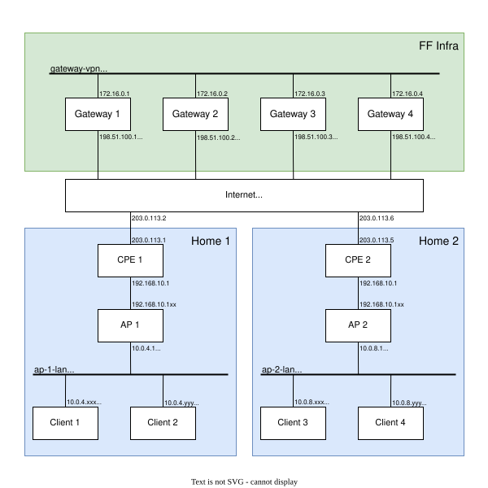

## Overview

This lab setup deploys a full Parker-style network, consisting of:
- Four gateways, each of which runs:
  - WireGuard tunnel termination
  - Direct routing of the internal IPv6 space to the internet
  - NAT64 translation from 64:ff9b::/96 to a public IPv4
  - A wgkex worker, which sets up the WireGuard peers of the APs
  - A "VPN" between gateways for MQTT traffic (realized as a shared bridge here)
  - Basic firewalling to protect the VPN and the gateway itself
- The first gateway additionally runs:
  - The wgkex broker, which serves signed configurations to the APs
  - An MQTT broker (mosquitto) for the two of them to meet on
- One home, which has:
  - A CPE (representing a typical home router), which has an IPv4 internet uplink, a LAN with a DHCP server and NAT44 between them
  - Two APs running a Parker-enabled Gluon image, whose WAN ports are on that same CPE LAN and which mesh with each other over it
  - Two clients per AP, which are connected to its LAN port and run a DHCP client
- An "internet" container which runs BGP peering with the gateways and has a static link to the CPE

(The picture still shows the two separate homes and the etcd-era gateways.)

On top of that, there's some scripting in the AP container to automatically configure them by setting hostname, config server, config signing key, mesh role, SSH key and rebooting out of config mode.
See [LAB-WGKEX.md](LAB-WGKEX.md) for what the gateways run since the move from etcd-tools to wgkex, and for what to look at when checking whether it works.

The Gateways and APs are set up as VMs, while the other functions (internet, CPE, client) are pure containers.
Since containerlab is built around containers, those VMs are packaged as a container as well.

The AP image is an unmodified Gluon build, while the Gateway images are built using Packer by taking an official Ubuntu Cloud image and running Ansible on it.

For a real gateway setup, the "lab-net" role in Ansible should be adjusted/replaced. For example, the VPN would be an actual VPN there, not a Linux bridge,
and the BGP peering would need to be adjusted for the actual peer router.

## Relevant IPs
### IPv4
- `203.0.113.0/24`: Sample ISP
  - `203.0.113.0/30`: The home
    - `203.0.113.1`: CPE side of the link
    - `203.0.113.2`: Internet side of the link
  - `203.0.113.42`: The "internet" container itself (useful target for pinging from a client to see if end-to-end connectivity works)
- `198.51.100.0/24`: Public Freifunk IPv4 range
  - `198.51.100.1-14`: The public IPs of the four gateways, used for the WireGuard tunnels
  - `198.51.100.11-14`: The public IPs of the NAT64 translator on the four NAT64 gateways
- `10.0.0.0/16`: Private Freifunk IPv4 range
  - `10.0.4.0/22`: The client range, the same one on every AP - with 464XLAT it never leaves the node
    - `10.0.4.1`: Every AP, unless it finds another one already using the address
    - `10.0.4.2-15`: Where an AP moves to when it does
- `172.16.0.0/24`: The gateway VPN
  - `172.16.0.1-4`: The four gateways
- `192.168.10.0/24`: The home LAN
  - `192.168.10.1`: The CPE
  - `192.168.10.100-199`: The clients (e.g. the WAN ports of the two APs)

### IPv6
- `2001:db8:ff00::/48`: Public Freifunk IPv6 range
  - `2001:db8:ff00::/64`: Freifunk Infrastructure
    - `2001:db8:ff00::1-4`: The four gateways
    - `2001:db8:ff00::1:1-4`: The four NAT64 translators (for e.g. traceroute)
  - `2001:db8:ff00::/63`: Reserved, never handed to an AP
  - `2001:db8:ff00:2::/63`: The first AP block, assigned to whichever one asks first
    - `2001:db8:ff00:2::/64`: Its client network, `2001:db8:ff00:2::1` the AP itself
    - `2001:db8:ff00:3::/64`: The range its CLAT translates client IPv4 into
  - `2001:db8:ff00:4::/63`: The second AP block, assigned to whichever one asks second
  - ... (more APs, one /63 each)
- `2001:db8:cafe::1`: The "internet" container itself (useful target for pinging from a client to see if end-to-end connectivity works)
- `64:ff9b::/96`: The NAT64 prefix
  - `64:ff9b::203.0.113.42`: Example of a IPv6-mapped public IPv4 address, should be pingable from clients

## Setup steps

- ensure you have about 96GB of available disk space
- Install Packer, Ansible, docker, qemu-utils and containerlab
  - `setup-debian.sh` walks through these steps for a Debian-based host
- Set up the bridges (exposed to the host for flexibility) and let bridged
  traffic through the host firewall: `sudo ./lab-bridges.sh`
  - docker enables br_netfilter, so every frame bridged between two lab nodes
    also traverses the host's iptables chains, where docker's FORWARD policy
    is DROP -- and a firewall doing strict reverse-path filtering drops it as
    well, since the host has no routes to the lab subnets. ARP is not IP and
    passes both, so the lab deploys and resolves addresses while nothing gets
    through. The script exempts the lab bridges from both; re-run it after a
    reboot.
- Build containers:
  - Check out wgkex next to this repository, or point `WGKEX_SRC` at your checkout
  - Download x86-64 Gluon image, extract `gluon-ffmuc-<version>-x86-64.img` into `gluon/`
  - Run `./build.sh`
- Bring containerlab up: `sudo containerlab deploy`
  - Without a containerlab install, the containerized release works just
    as well and only needs the docker socket:
    `docker run --rm --privileged --network host --pid host -v /var/run/docker.sock:/var/run/docker.sock -v /var/run/netns:/var/run/netns -v $PWD:$PWD -w $PWD ghcr.io/srl-labs/clab:0.71.0 containerlab deploy -t ffmuc.clab.yml`
- Check the state:
  - For serial on gateway: `docker exec -it clab-ffmuc-gateway-gw02 telnet 127.0.0.1 5000`
    - the user name and password is ubuntu and ffmuc (see `gateway/packer/gateway.pkr.hcl`)
  - For FRR console on internet: `docker exec -it clab-ffmuc-internet vtysh`
  - For serial on AP (after setup has completed): `docker exec -it clab-ffmuc-ap-1 telnet 127.0.0.1 5000`
  - For shell on client: `docker exec -it clab-ffmuc-client-1 bash`
  - Non-interactively, `./node-cmd.sh ap-1 'wg show all'` runs one command
    on a VM's serial console and prints its output (it logs into the
    gateways by itself)
- Bring containerlab down: `sudo containerlab destroy`

## TODOs
- Containerize the gateway?
  - Network container (sets up interfaces, firewall and routing)
  - Mgmt container (runs wgkex and MQTT)
- Redraw `overview.svg`: one home with two meshing APs, and wgkex instead of etcd
- Run a second wgkex broker so the lab survives gw01 going away
